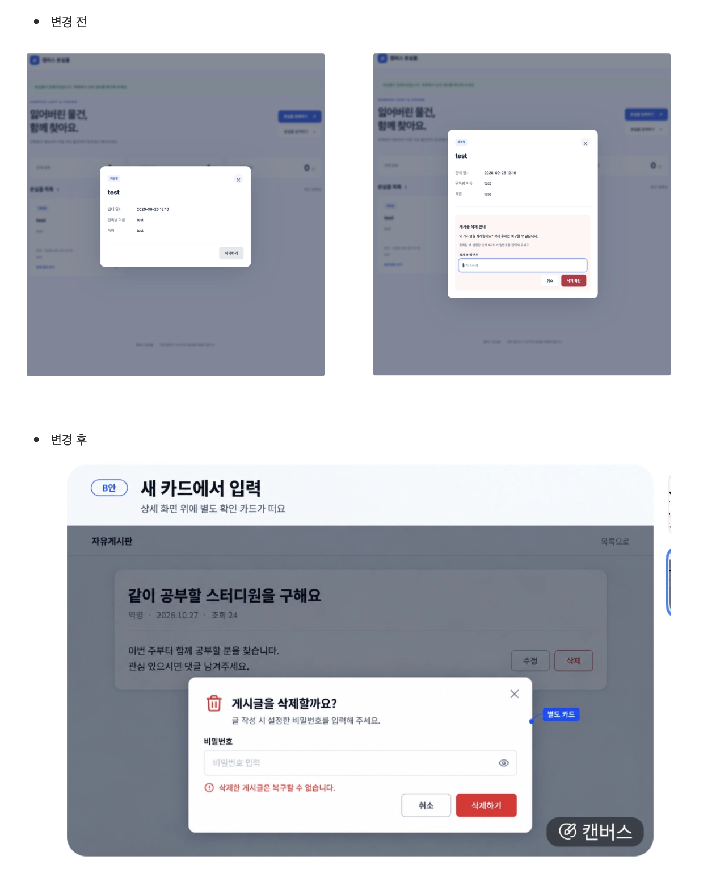
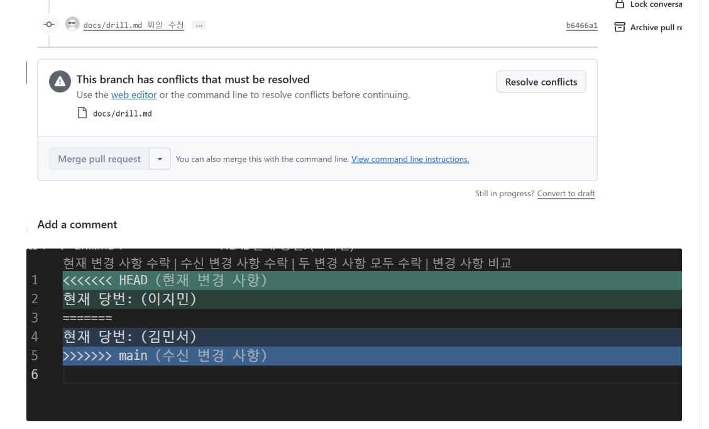
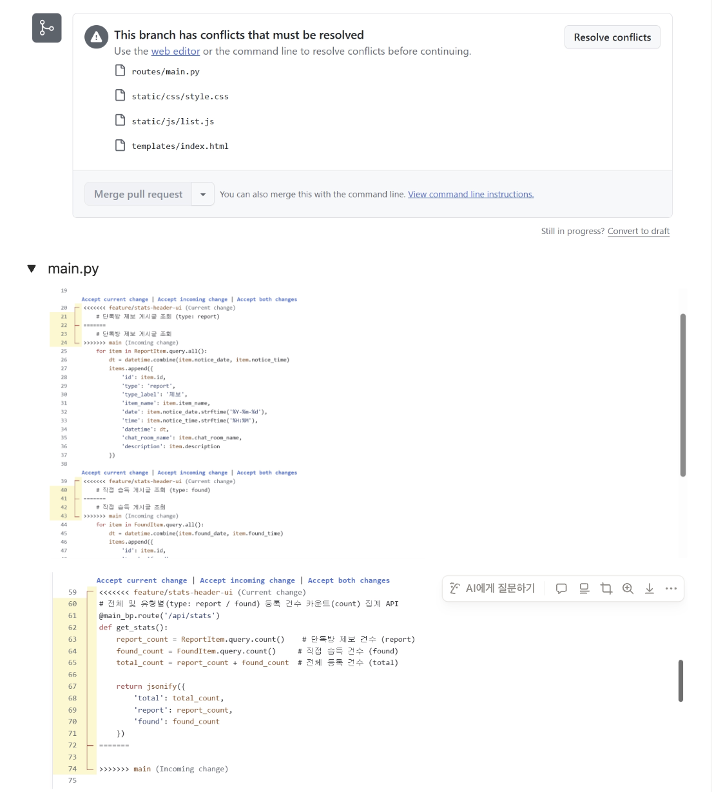
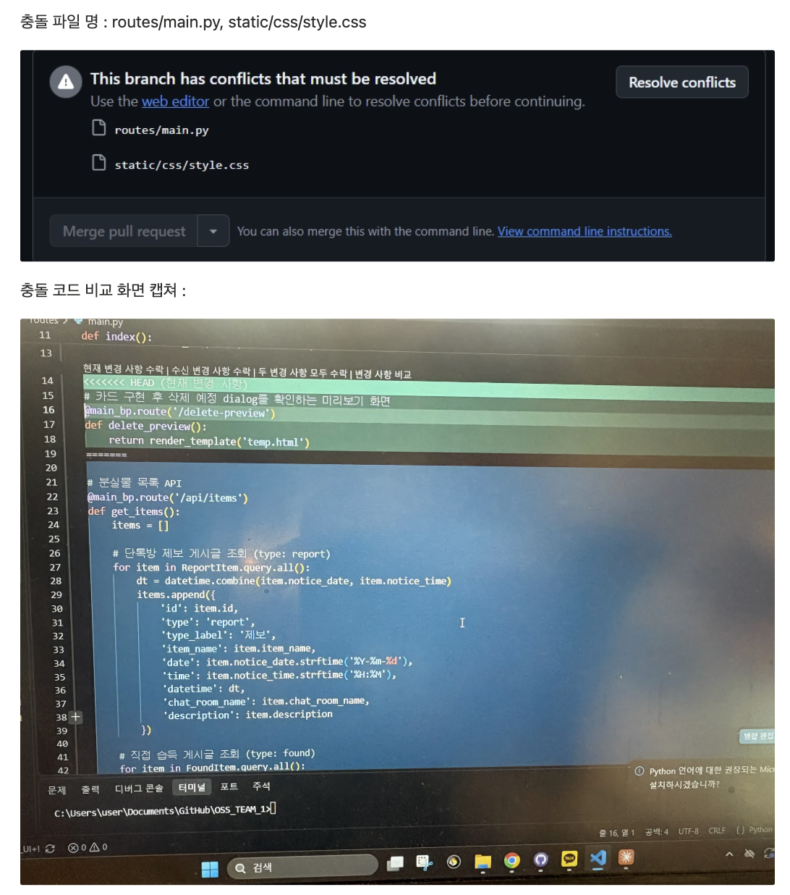

# [WEEK10] 회의록 — Gitter
- 일시: 2026-10-30 (금) 13:00 ~ 14:00
- 방식: 대면 회의
- 참석: 김민서, 강정우, 이지민 / 불참: 이정주 (병원)
- 서기: 강정우

## 1. 지난주 회의 내용 리마인드

| 결정 사항 | 담당 | 완료 | 비고 |
|---|---|---|---|
| 중간고사 잘 치기 😊| 공통 | 완료 | 10/26 23:59 |
| 브랜치 생성, 담당 기능 기본 세팅 코드 커밋 및 원격 푸시 | 민서 | 완료 | 10/28 18:00 |
| 브랜치 생성, 담당 기능 기본 세팅 코드 커밋 및 원격 푸시 | 정우 | 완료 | 10/28 18:00 |
| 담당 기능 기본 세팅 코드 커밋 | 지민 | 완료 | 10/28 18:00 |
| 개인 활동 로그 및 진행 상황 체크 | 공통 | 완료 | 10/28 18:00 |
| 개인 활동 로그 및 진행상황 체크 후 회의록 제출 | 민서 | 완료 | 10/28 18:00 |
| 사용하지 않는 브랜치 삭제 | 정주 | 완료 | — |
|---|---|---|---|
| 전체 분실물 카드 목록 UI 구현 | 정주 | 완료 | 10/26 23:00 |
| 상단 요약 통계 UI 구현 | 정주 | 완료 | 10/26 23:00 |
| 검색 인터페이스 구성 | 민서 | 완료 | 10/28 12:00 |
| 등록 폼 입력 UI 구현 | 지민 | 완료 | 10/28 18:00 |
| 삭제 인터페이스 구성 | 정우 | 완료 | 10/28 18:00 / 새 토글로 띄울 예정, 작업 가능 |

## 2. 활동 로그 (~11/04 18:00)
| 팀원 | 커밋 | 풀 리퀘스트(생성/병합) | 리뷰 | 이슈 | 충돌 해결 | 특이사항 |
|---|---|---|---|---|---|---|
| 김민서 | 5 | 4/4 | 20 | 3 | 0 | - |
| 강정우 | 9 | 3/3 | 4 | 0 | 2 | - |
| 이정주 | 7 | 4/4 | 1 | 0 | 1 | - |
| 이지민 | 13 | 7/7 | 11 | 0 | 1 | - |

## 3. 팀원별 진행 상황 (~11/04 18:00)
| 팀원 | 한 일 (이슈/풀 리퀘스트 번호) | 막힌 점 |
|---|---|---|
| 김민서 | #27 9주차 충돌 해결 실습 준비 PR 병합 | 없음 |
| | #28 docs/drill.md 파일 PR 병합 | 없음 |
| | #32 현재 당번 수정 파일 PR 병합 | 없음 |
| | #39 MVP 시연용 더미 데이터 추가 및 사용법 설명 이슈 생성 | 없음 |
| | #40 MVP 시연용 더미 데이터 PR 병합 | 없음 |
| | #44 검색 인터페이스 구현 PR 병합 | 없음 |
| 이정주 | #2 분실물 게시글 상세 보기 기능 구현 | 없음 |
| | #3 빈 목록 및 데이터 로딩 예외 처리 | 데이터가 로딩되지 않았을 때의 상황을 구분하는 기준 설정에 어려움 |
| 이지민 | #5 비밀번호 숫자 4자리 유효성 검사 구현 | 없음 |
| | #6 bcrypt를 사용한 비밀번호 단방향 해싱 구현 | 없음 |
| | #25 Docs/agreements PR 생성 및 병합 | 없음 |
| | #26 Docs/meetings PR 생성 및 병합 | 없음 |
| | #29 docs/drill.md 파일 PR 충돌 해결 | 없음 |
| | #7 등록 데이터 저장소 연동 | 비밀번호 해싱 코드 누락으로 저장 시 NOT NULL 오류 발생. 저장 전에 bcrypt 해싱을 수행하도록 수정하여 해결 |
| | #36 등록 폼 UI 구현 PR 생성 및 병합 | 없음 |
| | #41 비밀번호 숫자 4자리 유효성 검사 PR 생성 및 병합 | 없음 |
| | #42 bcrypt 비밀번호 해싱 PR 생성 및 병합 | 없음 |
| | #43 등록 데이터 저장소 연동 PR 생성 및 병합 | 없음 |
| 강정우 | #32 현재 당번 이름 수정 | 없음 |
| | #33 당번 이름 수정 | 없음 |
| | #11 삭제 인터페이스 구현 | 없음 |
| | #50 삭제 인터페이스 구성 PR 병합 | 없음 |

## 4. 논의 내용과 결정 사항 (이유 포함)

<aside>

**안건 0 : 개발 진행 상황 공유**

</aside>

- 이번주 구현 부분의 코드와 동작 원리 설명
- 김민서: 검색 인터페이스 구성
- 이정주: 분실물 카드 목록, 상단 요약 통계
- 이지민: 등록 폼, 비밀번호 유효성 검사, bcrypt 해싱
- 강정우: 삭제 모달 UI 및 열기·닫기 구현

<aside>

**안건 1 : PR 템플릿 수정 및 AI 사용 내역 작성**

</aside>

- PR 템플릿에 AI 도구 사용 여부·도구명·활용 범위 항목 추가
- 10/28 대면 작업에서 수정 완료
- 기능 PR 작성 시 AI 사용 내역 기재 필수

<aside>

**안건 2 : 기능별 브랜치 생성 확인**

</aside>

- 담당 기능 브랜치 생성, 기본 동작 코드 커밋 및 원격 푸시 확인
- 민서: `feature/search-layout`
- 정주: `feature/lost-item-card-ui`
- 지민: `feature/register-form-ui`
- 정우: `feature/delete_interface_UI`

<aside>

**안건 3 : 개인 개발 일정 점검**

</aside>

- 조회·등록 최종 완료 목표: 11/1 23:59
- 검색·삭제 최종 완료 목표: 11/22 23:59
- 최종 일정에 지장이 없는 범위에서 개인 일정 조정
- 이슈별 개발 계획 및 기능별 이슈 분류 재확인

<aside>

**안건 4 : 프로젝트 규칙 및 이슈 기록 안내**

</aside>

- 협업 루틴과 GitHub 사용 규칙 재확인
- 협업·개발 중 발생한 문제를 이슈 모음에 기록
- 개발 중 막힌 사항은 질문 이슈로 개인별 1~2회 등록 권장함을 인지

<aside>

**안건 5 : 타 팀 기여용 이슈 준비**

</aside>

- 중간발표 전 `good first issue` 라벨 이슈 2개 이상 등록 완료
- 상대 팀이 등록된 이슈 중 1개 선택 예정
- 2팀 기여 후보 확인 & 검토 (문서 개선, CSS 통일 작업)

<aside>

**안건 6 : 문서 브랜치 병합**

</aside>

- `agreements`, `meetings` 브랜치 PR 생성 및 병합 완료
- PR : 이지민
- 리뷰 : 강정우

<aside>

**안건 7 : 중간보고서 및 발표 준비**

</aside>

- 핵심 구성: 실제 동작 기능 2개 및 협업 기록
- 김민서: 시연용 더미 데이터 준비
- 담당 코드의 함수 및 각 줄의 필요성을 설명할 수 있도록 다시 한 번 정리

<aside>

**안건 8 : 삭제 창 UI 변경 논의**

</aside>

- 삭제 창 변경 전·후 화면 비교 및 구성 검토
- 현재 구현된 삭제 모달의 동작과 후속 개발 범위 재확인
- 아래 사진은 실제 구현 화면이 아니며, 참고를 위한 예시임

<aside>

**안건 9 : 충돌 해결 실습 및 기록 리뷰**

</aside>

- 실습 해결 진행 완료 
- 정주는 민서와 11/5(목) 진행 예정
  

- **현재까지의 충돌 기록 리뷰**
- 10/30 이지민: `docs/drill.md` 충돌 해결 기록 공유
◊
- 11/1 이정주: `main.py`, `style.css`, `list.js`, `index.html` 충돌 기록 공유

- 11/3 강정우: `routes/main.py`, `static/css/style.css` 충돌 기록 공유

- **충돌이 발생하면, main 브랜치를 내 브랜치로 머지하여 충돌을 해결 한 후,main으로 다시 머지하였음**

## 5. 다음 주 할 일  
- [x] (민서) 11월 1일 일요일 18:00 시연을 위한 더미데이터 준비
- [x] (공통) 11월 3일 23:59까지, PR 작성, 지정 리뷰어 > 병합 > 충돌 나면 기록, 단톡 보고 > 머지까지 마무리
🔥 충돌이 나면 내 브랜치에 최신 main을 가져와 해결하고, 다시 머지합니다. (주의) 충돌 상황을 아래 노션 페이지에 상세히 기록해두기 ! (필수)
    - https://app.notion.com/p/409c130a7cab805db95ffac8f4a77e3c?source=copy_link
- [ ] (공통, 선택사항) 11월 4일 18:00 개발하며 막힌 사항을 이슈로 등록 - 어떤 기능 브랜치에서 새 브랜치 생성 - 개발 - 원래 기능 브랜치에 다시 병합 (안내서에 있었으니까 강력 추천)
- [x] (공통) 11월 4일 18:00 활동 로그 / 진행 상황 작성
- [x] (공통) 11월 4일 23:59 PPT 제작 , 대략적인 대본 작성
- [ ] (공통) 11월 5일 23:59 각자 맡은 발표 파트 대본 재수정

## 6. 다음 주 할 일 - 기능 관련 상세
| 할 일 | 담당 | 마감 | 이슈 |
|---|---|---|---|
| 분실물 게시글 상세 보기 기능 | 이정주 | 10/31 23:00 | #2 |
| 빈 목록 및 데이터 로딩 예외 처리 | 이정주 | 10/31 23:00 | #3 |
| 등록 데이터를 저장소에 저장하고 정상 저장 여부 확인 | 이지민 | 11/1 23:59 | #7 |
| 비밀번호 해싱 및 검증 로직 개발 | 강정우 | 11/3 23:00 | #11 |

## 7. 이번 주 점검표 (부록 A 9주차)
- [x] 기능 첫 PR, 리뷰, 병합 “PR 1개 = 이슈 1개”
- [x] (팀장) 브랜치 보호 - 안내서 20p
- [x] 2인 1조로, 부록 D-2 충돌 해결 실습
- [x] (지민, 정주) 기능 2개 완성 
