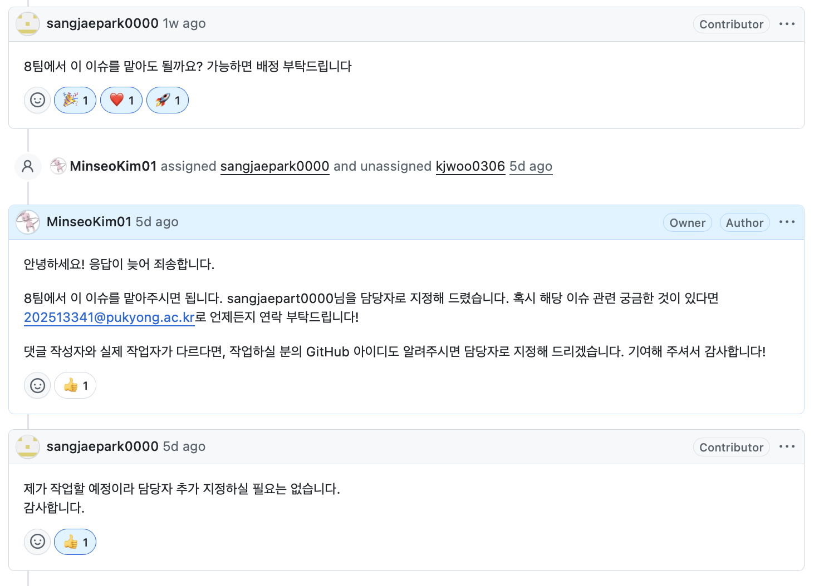
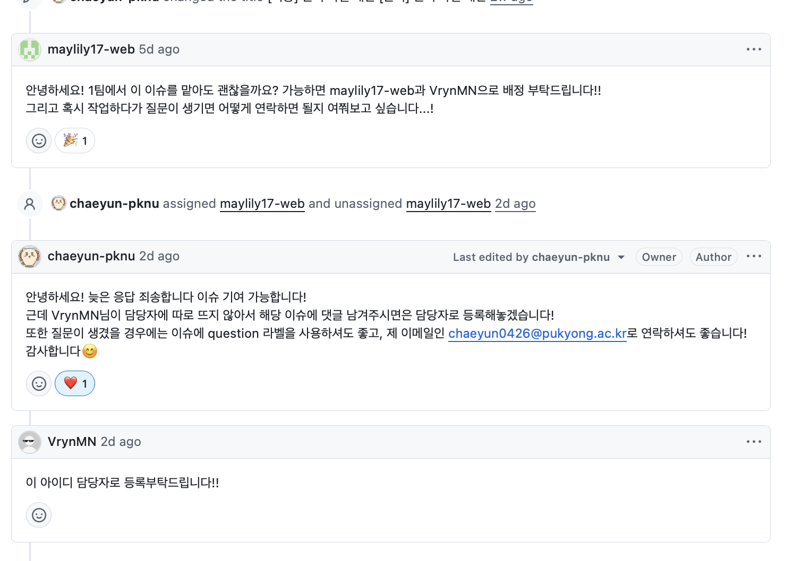
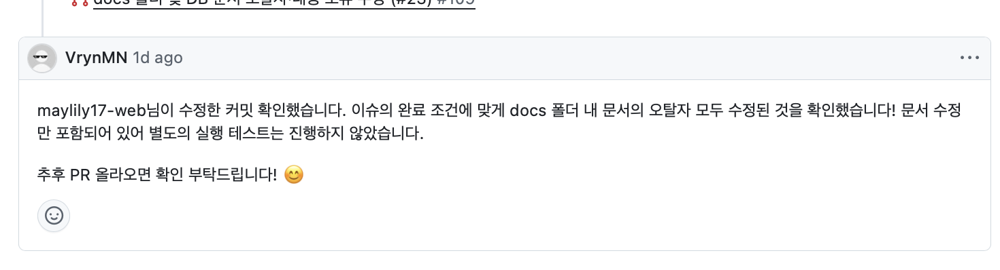

# [WEEK12] 회의록 — Gitter
- 일시: 2026-11-13 (금) 13:00 ~ 14:00
- 방식: 대면 회의
- 참석: 김민서, 강정우, 이정주, 이지민 / 불참: 없음
- 서기: 강정우

## 1. 지난주 회의 내용 리마인드

| 결정 사항 | 담당 | 완료 | 비고 |
|---|---|---|---|
| 활동 로그 및 진행 상황 작성 | 공통 | ✅  | 11월 11일 18:00까지 |
| 개인 규칙 준수 여부 체크 | 공통 | ✅ | 11월 11일 18:00까지 이번 회의록 안건 0에 체크 |

**한 주 널널했으니까! 다시 열심히하자! 기능 디벨롭 & 타 팀 기여 & 최종 대비 시작하기!**

## 2. 활동 로그 (~11/18 18:00)
| 팀원 | 커밋 | 풀 리퀘스트(생성/병합) | 리뷰 | 이슈 | 충돌 해결 | 특이사항 |
|---|---|---|---|---|---|---|
| 김민서 | 0 | 1/1 | 8 | 0 | 0 | - |
| 강정우 | 3 | 2/2 | 1 | 2 | 0 | - |
| 이정주 | 3 | 2/2 | 2 | 2 | 0 | - |
| 이지민 | 3 | 3/3 | 3 | 3 | 1 | - |

## 3. 팀원별 진행 상황 (~11/18 18:00)

| 팀원 | 한 일 (이슈/풀 리퀘스트 번호) | 막힌 점 |
|---|---|---|
| 김민서 | #72 분실물 이름과 날짜 범위 함께 검색 PR 후 병합 | - |
| | #35 우리 팀에 온 배정 요청 응답 | - |
| | #68 8팀에서 온 기여 PR 병합 | - |
| 강정우 | #73 삭제 전 확인 문구 추가 이슈 생성 | - |
| | #74 검증 완료 데이터 삭제 연산 구현 PR 후 머지 | - |
| | #75 삭제 전 확인 문구 추가 PR 후 머지 | - |
| | #76 배포 관련 질문 이슈 등록 | - |
| 이정주 | #66(이슈) 분실물 목록 카드 마우스 호버(Hover) 시 그림자 효과 구현 | - |
| | #67(이슈) 분실물 목록 빈 화면(Empty State) 캐릭터 적용 및 UI 개선 | 캐릭터 이미지 경로 오류로 출력되지 않아 경로 재설정 |
| | #69(PR) 분실물 목록 카드 마우스 호버(Hover) 시 그림자 효과 구현 | - |
| | #71(PR) 분실물 목록 빈 화면(Empty State) 캐릭터 적용 및 UI 개선 | - |
| | #23 이슈 배정 댓글 달기(타 팀 기여) | - |
| | #23 문서 파일 개선(타 팀 기여) 코드 작업 | - |
| 이지민 | #60 등록 버튼 연속 클릭 시 중복 저장 방지 구현 | - |
| | #61 분실물 등록 성공 시 완료 알림 표시 구현 | - |
| | #62 날짜 및 시간 입력 시 미래 일시 제한 구현 | 미래 일시 입력 시 경고만 표시되어, 입력 범위 제한 및 입력값 초기화로 해결 |
| | #63 중복 저장 방지 PR 생성 | - |
| | #64 완료 메시지 표시 PR 생성 | - |
| | #65 미래 일시 제한 PR 생성 | 충돌 발생 후 해결 |

## 4. 논의 내용과 결정 사항 (이유 포함)

<aside>

**안건 0 : 현재까지의 규칙 준수 여부 체크 후 계획하기**

</aside>

- 확인 기준: 11월 12일 18:00까지
- 규칙 준수 체크: 커밋 ✅ / PR ✅ / 리뷰 ✅
- 추가로 필요한 이슈: 김민서 +1, 이지민 +4, 이정주 +3, 강정우 +3

- 각자 기능에서 디벨롭할 것을 생각하는 시간을 가짐
- 그 결과 아래와 같은 활동을 하기로 결정함. 

 

- 개발 중 막힌 사항 또는 기능적으로 부족한 부분을 enhancement 등 개발 이슈로 등록 (이지민, 이정주, 강정우)
- 이슈에 따른 추가 기능 개발 마무리 기한: 11월 17일 23:59

- 기술적으로 막힌 부분 또는 기능 동결 후 부족한 부분을 question 라벨 이슈로 등록 (강정우)
- 배포 코드 수정 및 중간 발표 피드백 이슈 등록 (김민서)

 

- 문서 정비 관련 이슈 등록 후 작업 (12주차에 작업 예정, 문서 정비 마무리 기한: 12월 2일)
- 이지민 · 이정주 · 강정우가 아래 항목 중 각 1개씩 추가 진행 예정 (세부 담당 미지정)
  - CSS 파일 정리
  - docs 파일 정리 (db README 포함)
  - 캐릭터 설명 문서 추가

  

<aside>

**안건 1 : 기능 별 디벨롭 / 추가 이슈 계획**

</aside>

김민서 — 배포 이슈 1개, 배포 관련 코드 수정 및 이슈 등록

이지민 — 기능 개선 이슈 3개 
1. 등록 버튼 연속 클릭 시 중복 저장 방지
   - 저장 후 목록 이동만으로는 서버 응답 전 버튼을 여러 번 누르는 중복 제출을 막을 수 없음
   - 첫 제출 이후 버튼을 비활성화하고, 실패하면 재시도 가능하도록 처리
2. 분실물 등록 성공 시 완료 메시지 표시
   - 목적: 목록으로 이동한 직후 사용자가 등록 성공 여부를 확인하도록 개선
   - 작업: 제보형·습득형 게시글 정상 저장 후 목록 상단에 분실물이 등록되었습니다. 표시
   - 완료 조건: 성공 시 한 번만 안내, 새로고침 시 재표시하지 않음, 실패 시 기존 오류 안내 유지
3. 날짜/시간 입력 시 미래 일시 제한
   - 개선 내용: 안내 일시·습득 일시는 이미 일어난 사건의 기록이므로 미래 일시 입력을 제한
   - 완료 조건: 제보형·습득형 모두 미래 일시를 서버에서 거부하고 현재·과거 일시는 허용

이정주 — 기능 개선 이슈 2개
- 분실물 등록 전 빈 페이지에 모아줍 캐릭터를 활용한 UI 변경
- 목록 카드에 마우스를 올렸을 때 그림자 효과 추가

강정우 — 기능 개선 이슈 1개, 질문 이슈 1개
- 삭제 전 확인 문구 추가
- 기술 또는 기능 관련 question 이슈 등록

 
<aside>

**안건 2 : 타 팀 기여**

</aside>

타 팀 기여 시 유의사항
- 상대 팀의 CONTRIBUTING.md를 먼저 읽고 해당 규칙 준수
- 이슈 배정 전에 작업을 시작하지 않으며 배정된 이슈 범위 내에서만 수정
- 병합된 PR 링크를 회의록 활동 로그와 최종 보고서에 기록
- 자세한 절차는 팀 프로젝트 안내서 11장(타 팀 저장소에 기여하기) 참고

기여 대상
- 매칭된 2팀의 이슈 1개 선택: [문서] 문서 파일 개선
- https://github.com/chaeyun-pknu/pknu-finder/issues/23

주차별 타팀 기여 일정

11주차
- [x] 11월 13일 23:59 — Fork 및 협력자 등록 (김민서)
- [x] 11월 13일 23:59 이전 — 우리 팀에 온 배정 요청 응답, 24시간 이내 답변 및 담당자 지정 (김민서)
- 
- [x] 11월 14일 12:00 이전 — 이슈 댓글로 배정 요청 (이정주)
- 
- [x] 11월 17일 23:59 — 상대 팀 이슈 코드 작업 (이정주)
- [x] 11월 18일 18:00 — 실행 확인 (이지민)
- 
- [x] 11월 19일 18:00 — 설명 및 회의록 작성

12주차
- [ ] 11월 20일 23:59 — 타 팀에 PR 제출 (이지민)
- [X] 리뷰 도착 후 48시간 이내 — 우리 팀에 온 PR 리뷰 (강정우) - 11주차에 완료

13주차
- [ ] 리뷰 도착 후 — 리뷰 내용을 반영해 코드 수정이 필요한 경우 (강정우, 일정 추후 지정)
- [ ] 2팀·8팀과 상의하며 요구사항과 작업 방향 확인 (김민서)
- [ ] 타 팀에 기여한 코드가 병합되었는지 확인 (팀장)
- [x] 우리 팀에 온 PR 병합 (팀장, 완료) (https://github.com/MinseoKim01/OSS_TEAM_1/pull/68) - 11주차에 완료

 
<aside>

**안건 3 : 우리 팀 기능 디벨롭 관련 계획 재정리**

</aside>

- 11월 17일: 전체 기능 구현 완료 및 추가 기능 개발 마감
- 11월 18일: 기능 PR 병합 마감
- 11월 19일: 배포 예정
- 11월 20일 회의: 전체 기능 테스트 — 제안서에 제안한 주요 기능이 동작하는지 확인
- 12월 4일: 최종 점검 및 릴리즈 예정

 
<aside>

**안건 4 : 최종 보고서, 최종 발표 준비**

</aside>

- 이번 주부터 최종 보고서와 발표 준비 시작
- 11월 20일, 11월 27일, 12월 4일, 12월 11일 회의에서 최종 발표 준비 진행
- 목표: 12월 11일에는 대부분의 준비가 끝나있는 것을 목표로 진행
- 이번 주 최종보고서, 최종 발표 준비 업무는 간단하게 진행

- [ ] 충돌 해결 사례 1개 정리
  - 충돌 발생 시 반드시 기록하고 단체 채팅방에 보고
- [ ] 개인별 기여 내용 작성
  - 실제 구현 내용을 2~3문장 이내로 요약
- [ ] 기술적 문제 해결 사례 각 1개 정리 (이정주)
- [ ] 협업 관련 문제 해결 사례 정리 (김민서)

## 5. 다음 주 할 일 (~ 11월 20일 회의 전까지의 할 일)
- [x]  (민서) 11월 13일 23:59 이전, 우리 팀에 온 배정 요청 응답 (24시간 이내 답변/담당자 지정)
- [x]  (정주) 11월 14일 12:00 이전, 이슈에 댓글로 배정 요청
- [x]  (민서) 11월 14일 23:59 Fork 협력자 등록
- [x]  (정주) 11월 17일 23:59 상대 팀 이슈 코드 작업
- [x]  (지민) 11월 18일 18:00 실행 확인 1명
- [x]  (공통) 11월 18일 18:00 활동 로그 / 진행 상황 작성
- [x]  (민서) 11월 19일 18:00 회의록 작성 (타 팀 기여 설명 추가) 후 제출
- [ ]  (공통) 11월 20일 11:00 개인별 담당 기능에 대한 설명 + 추가 이슈에 대한 설명 정리해서 2-3문장 이내로 요약 (11주차 안건 3 내의 페이지에 작성)
- [ ]  (정주) 11월 20일 11:00 기술적인 부분 문제해결 작성 (https://app.notion.com/p/3f8c130a7cab8050b6d6dc864911b97f?source=copy_link)
- [ ]  (민서) 11월 20일 11:00 협업적인 부분 문제해결 작성 (https://app.notion.com/p/3f8c130a7cab803b89cfca5ee3c1baaf?source=copy_link)

## 6. 다음 주 할 일 - 기능 관련 상세 (~ 11월 18일 18:00까지의 할 일)
| 할 일 | 담당 | 마감 | 이슈 |
|---|---|---|---|
| 다중 조건 필터링 검색 연산 구현 PR | 김민서 | 11/17 23:59 | #72 |
| 배포 (관련 이슈 등록 후 작업, PR까지, 피드백 내용 추가) | 김민서| 11/20 04:00 | 19일-20일 예정 |
| 검증 완료 데이터 삭제 연산 구현 | 강정우 | 11/17 23:59 | #13 |
| 삭제 전 확인 문구 추가 | 강정우 | 11/17 23:59 | #73 |
| 질문 이슈 등록 | 강정우 | 11/17 23:59 | #76 |
| 분실물 등록 전 빈 페이지에 모아줍 캐릭터 활용하여 UI 변경 | 이정주 | 11/17 23:59 | #67 |
| 목록 카드 위에 마우스를 올리면 뒤에 그림자 | 이정주 | 11/17 23:59 | #66 |
| 등록 버튼 연속 클릭 시 중복 저장 방지 이슈 등록 | 이지민 | 11/17 23:59 | #60 |
| 분실물 등록 성공 시 완료 메시지 표시 이슈 등록 | 이지민 | 11/17 23:59 | #61 |
| 날짜/시간 입력 시 미래 일시 제한 이슈 등록 | 이지민| 11/17 23:59 | #62 |

 

- 앞으로의 일정 매우 간단 요약
- 17일 23:59 까지 정우님 question이슈 제외 모든 이슈/기능 마무리
- 18일 23:59 내로 PR > 머지 완료
- 20일 04시 전까지 배포 완료
- 20일 회의 시간 : 전체 기능 테스트
- 12월 4일 : 최종 점검 & 릴리즈

## 7. 이번 주 점검표 (부록 A 11주차)
- [X] 상대팀 이슈 선택, 배정 요청
- [X] (팀장) Fork, 협력자 등록
- [X] fork에서 작업
- [X] 우리 저장소에 온 요청 응답
- [X] 회의록 #7

---

(참고) 활동로그/진행상황/다음주 할 일이 없을 경우 '없음 - 사유' 표기하기